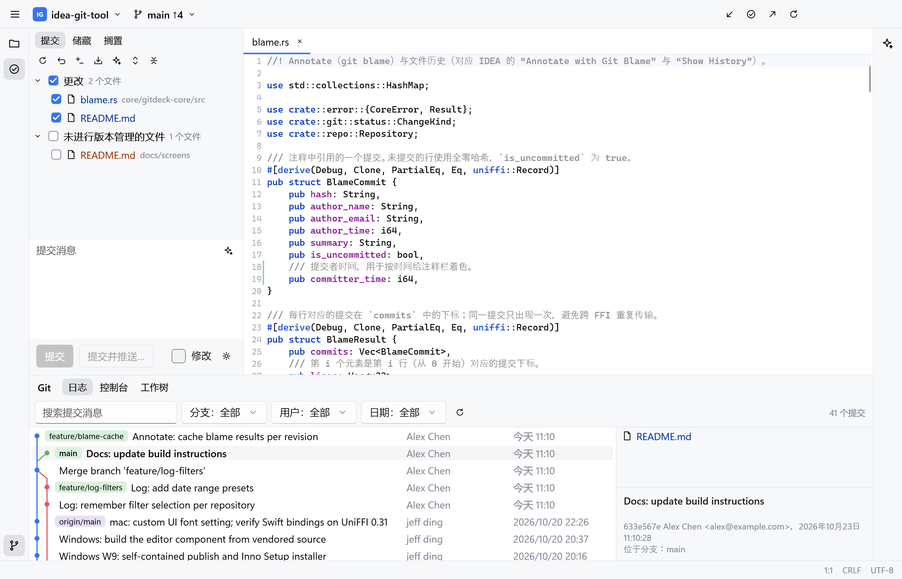
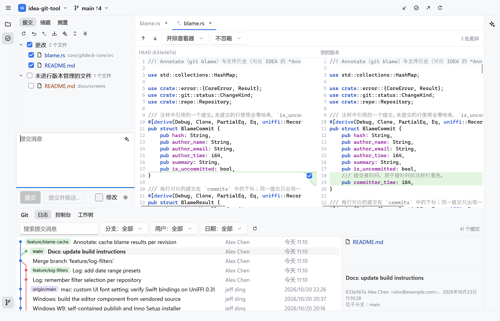
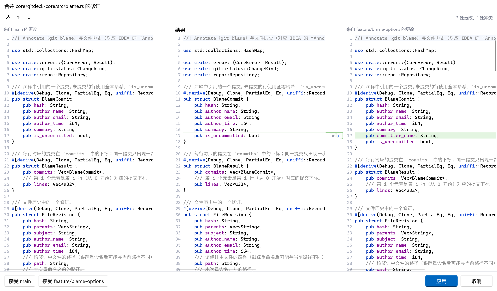
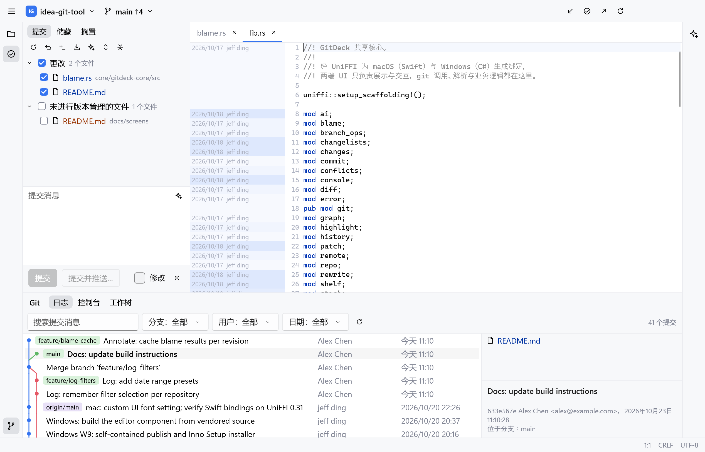
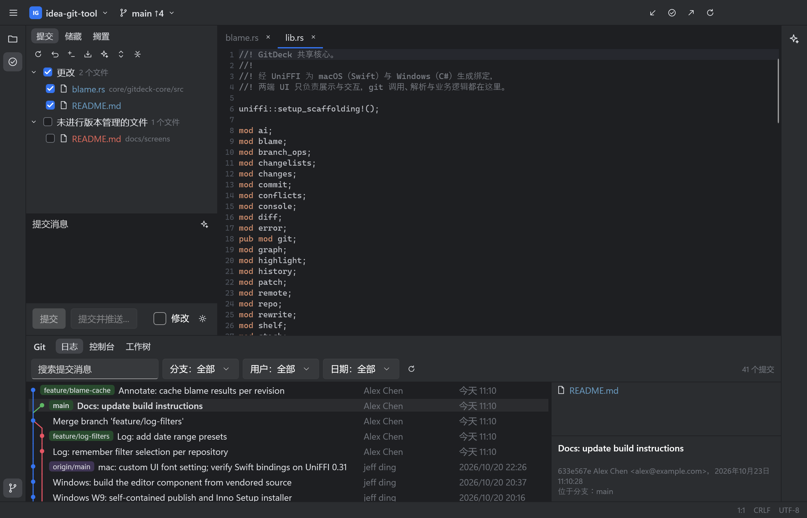

# GitDeck（代号）

[English](README.md) | 简体中文

对齐 JetBrains IDEA Git 功能的跨平台原生 Git 客户端：交互与界面以 IDEA New UI 为基准，内置带语法高亮的编辑器，并支持 AI 代码评审。macOS 用 Swift + AppKit，Windows 用 C# + WinUI 3，git 操作统一在 Rust 共享核心中实现。



## 下载

**Windows x64**：从 [Releases](https://github.com/dinjufen/idea-git-tool/releases/latest) 下载 `GitDeck-<版本>-x64-setup.exe` 运行即可。按用户安装到 `%LOCALAPPDATA%\Programs\GitDeck`，无需管理员权限。

- 需要 Windows 10 1809+ 和 [Git for Windows](https://git-scm.com/download/win) 2.30+（GitDeck 不内置 git，找不到时欢迎页会提示，也可以在设置中指定路径）。
- 安装包暂未签名，SmartScreen 提示时选择“仍要运行”。
- 卸载只删除程序文件，设置（`%LOCALAPPDATA%\GitDeck`）与凭据管理器中的 API Key 会保留。

**macOS**（Apple Silicon，macOS 15+）：暂未提供安装包，需从源码构建，见下文。

## 功能

| 类别 | 内容 |
|------|------|
| 仓库 | 打开、克隆、初始化；多仓库项目（窗口标签页 + 多根项目） |
| 提交 | Commit 工具窗口、Changelist、按块 / 按行部分提交、Amend、提交前检查 |
| 查看 | 并排 / 统一 Diff、Git Log 提交图（按分支 / 作者 / 日期 / 路径筛选）、提交详情、Annotate（blame）、文件历史 |
| 分支与同步 | Branches 弹窗（检出、新建、删除、重命名、合并、变基、比较）、Fetch、Pull、Update Project、Push |
| 冲突解决 | Conflicts 对话框 + 三栏合并（应用不冲突的更改、逐块接受、撤销） |
| 高级操作 | 交互式 Rebase、Cherry-pick、Revert、Reset、Undo Commit、Stash、Shelve、Tags、Remotes、Worktrees、Submodules、Patch、Git Console |
| 编辑器 | tree-sitter 语法高亮、查找替换、变更标记；界面字体与编辑器字体分别设置 |
| AI | 评审本地更改 / 已有提交 / 分支差异，AI 生成提交信息；支持 Anthropic 与 OpenAI 兼容接口（含本地 Ollama / LM Studio），只读 Agent，默认排除敏感文件 |
| 其他 | 简体中文 / 英文界面（术语对齐 IDEA 官方中文语言包）、浅色 / 深色主题 |

## 截图

以下截图来自 Windows 版。

**并排 Diff**：在提交工具窗口中查看本地更改，可按块勾选要提交的内容。



**三栏合并**：左右是两侧的更改，中间是合并结果。



**Annotate**：编辑器左侧显示每行最后修改的提交与作者。



**深色主题**



## 目录结构

```
core/gitdeck-core/     Rust 共享核心：git CLI 调用与解析、AI 评审（UniFFI 导出给 Swift / C#）
core/uniffi-bindgen/   绑定生成工具
apps/mac/              macOS 客户端（Swift + AppKit，SwiftPM 包）
apps/mac/Vendor/       第三方源码的 vendored 副本（各自保留 LICENSE，改动说明见其 Package.swift）
apps/windows/          Windows 客户端（C# + WinUI 3）与安装程序脚本
apps/windows/Vendor/   Windows 编辑器组件 WinUIEdit 的 vendored 源码
scripts/               构建与打包脚本
docs/                  决策记录、交接说明与截图
product.env            产品名与 Bundle ID（发布前统一替换）
deny.toml              依赖许可证白名单（cargo-deny）
```

架构与产品决策见 [docs/DECISIONS.md](docs/DECISIONS.md)；mac 端剩余事项见 [docs/MAC-REMAINING.md](docs/MAC-REMAINING.md)；Windows 端开发说明见 [docs/WINDOWS-HANDOFF.md](docs/WINDOWS-HANDOFF.md)。

## 从源码构建（macOS）

环境要求：Apple Silicon Mac，macOS 15+；Xcode（脚本默认使用 `/Applications/Xcode-beta.app`，可通过 `DEVELOPER_DIR` 覆盖）；Rust stable，目标 `aarch64-apple-darwin`；Git 2.30+。

```bash
scripts/build-mac-app.sh
```

```bash
open build/debug/GitDeck.app
```

发布构建：`scripts/build-mac-app.sh release`。

## 从源码构建（Windows）

环境要求：Windows 10 1809+ x64；Rust stable（MSVC 工具链）、Git for Windows 2.30+、.NET 10 SDK；Visual Studio 2022 或更新版本（“使用 C++ 的桌面开发”与“.NET 桌面开发”）。

```powershell
scripts/build-core-win.ps1
dotnet build apps/windows/GitDeck.sln
```

`build-core-win.ps1` 编译核心并用 `uniffi-bindgen-cs` 生成 C# 绑定（首次运行会把它安装到 `build/tools`）。

生成安装程序（需要 Inno Setup 6）：

```powershell
scripts/package-win.ps1
```

产物在 `build/windows/GitDeck-<版本>-x64-setup.exe`；`-Config Debug` 生成可与正式版并存的调试版。

## 测试

```bash
cargo test --workspace
```

## 开发约定

- 所有 git 操作在 Rust 核心中实现，UI 层只负责展示与交互。
- 界面文案全部放在 `apps/mac/Sources/GitDeck/Resources/Localizable.xcstrings`（en / zh-Hans），Windows 端直接读取同一文件；中文术语对齐 IDEA 官方中文语言包。
- 只引入 MIT / Apache-2.0 / BSD 等宽松许可的依赖（UniFFI 的 MPL-2.0 例外见决策第 12 项）。
